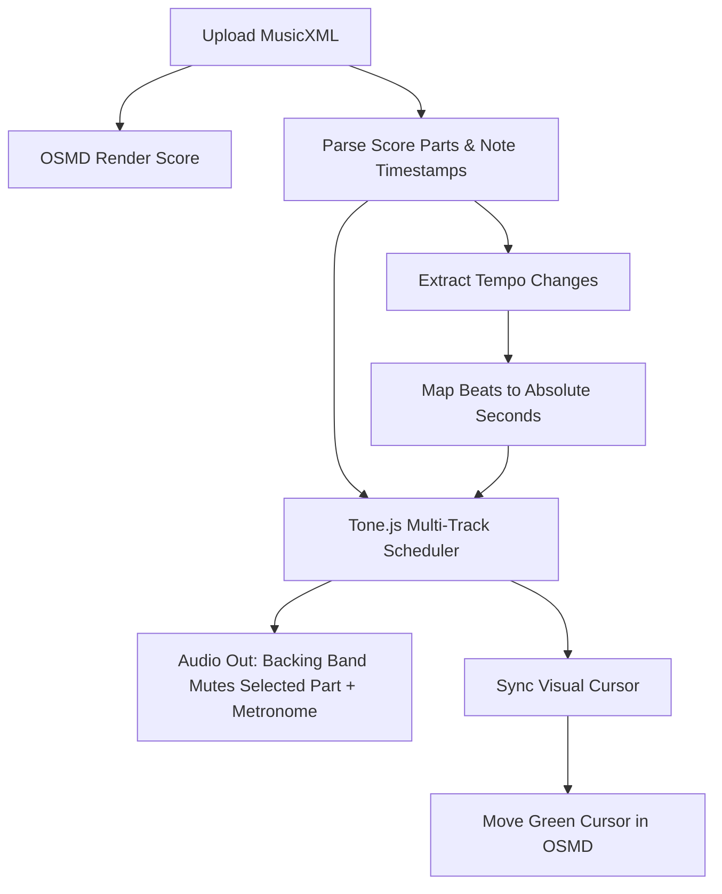

# ScoreFollower: Interactive MusicXML Score Sync & Practice Assistant (Wind Band Edition)

ScoreFollower is an interactive web-based music application designed specifically for wind band musicians (woodwinds, brass, and percussion). It allows players to load multi-part MusicXML files, render their specific instrument parts, play along with high-fidelity band accompaniments, and receive real-time visual feedback on their performance.

To ensure stability, error detection, and remediation, the project is structured in **two progressive deployment stages**.

---

## 📅 Roadmap & Stages

### 🎵 Stage 1: Notation, Playback, and Tempo Sync (Current Scope)
This stage builds the visual rendering, multi-track audio playback with instrument-specific sounds, dynamic tempo change tracking, and the synchronized tracker cursor.

1. **Multi-Track Backing Accompaniment:**
   - Parses MusicXML files to identify all instrument tracks.
   - Automatically maps score parts (e.g., Alto Saxophone, Trumpet in Bb, Flute) to corresponding high-quality General MIDI Soundfonts (FluidR3 GM) loaded dynamically from a public CDN.
   - **Minus-One Practice Mode:** Mutes the selected instrument part in the audio playback so the user can play it live, while all other instruments play as a backing band.
2. **Dynamic Tempo Change Handling:**
   - Extracts all tempo changes from the MusicXML.
   - Computes note events timing dynamically to ensure playback speeds up/slows down exactly as written.
3. **Interactive Sheet Music & Metronome:**
   - Renders beautiful notation. Toggle between Full Score and Single Part views.
   - **Adjustable Metronome:** Precise metronome beats that follow tempo changes, with options for volume adjustments, sound clicks, and mute.
4. **Visual Sync (Green Tracker):**
   - A vertical green cursor moves smoothly across the sheet music in sync with the backing track playback.

### 🎙️ Stage 2: Audio Input & Ahead/Behind Alignment (Next Scope)
This stage adds audio analysis, pitch tracking, transposition mapping, and visual timing feedback.

1. **Monophonic Microphone Pitch Tracking:**
   - Captures microphone input and runs pitch detection (YIN/McLeod) optimized for wind instruments.
2. **Instrument Transposition Mappings:**
   - Automatically transposes the detected concert pitch to match the written key of the user's instrument (e.g., Bb Clarinet, Eb Alto Sax, F Horn, C Flute).
3. **Score-Following Alignment:**
   - Compares the user's live performance notes and timestamps with the expected score notes.
4. **Visual Feedback:**
   - The main cursor turns **red** if the user plays ahead or behind the backing track.
   - Displays a secondary **ghost cursor** showing the user's current position relative to the main cursor.

---

## 🛠️ Open-Source Technology Stack (Stage 1)

| Component | Library/API | Purpose |
| :--- | :--- | :--- |
| **Visual Notation Rendering** | [OpenSheetMusicDisplay (OSMD)](https://github.com/opensheetmusicdisplay/opensheetmusicdisplay) | Renders MusicXML files to standard notation SVG inside the browser. Provides the `Cursor` API to navigate notes. |
| **Audio Synthesis & Sampler** | [Tone.js](https://tonejs.github.io/) | Web Audio framework for scheduling note events precisely down to the audio sample, managing playback state, and coordinating backing tracks. |
| **Wind Band Audio Instrument Sounds** | [General User GS Soundfont / FluidR3](https://gleitz.github.io/midi-js-soundfonts/) | Lightweight soundfonts containing realistic woodwind, brass, and percussion audio samples to play backing parts. |
| **Frontend Framework** | [Vite](https://vitejs.dev/) + React + TypeScript | Fast build environment and reactive state management for part selection, transposition, volume, and tracking indicators. |
| **Styling & UI Design** | Tailwind CSS / Vanilla CSS | Sleek, modern dark-themed dashboard with glassmorphic controls tailored for music stands. |

---

## 📐 Architecture & How It Works (Stage 1)



### 1. Multi-Track Synchronization
* When a MusicXML file is loaded, OSMD parses it into a multi-part sheet model.
* We map the parts (e.g., Flute 1, Clarinet in Bb, Trumpet 1) to individual tracks.
* If the user selects Alto Saxophone 1:
  - We mute the alto sax track in Tone.js (Minus-One mode).
  - We set OSMD's focus to the Alto Saxophone part.
* `Tone.Transport` orchestrates the timing. We play the backing instruments using separate synthesizers loaded with the appropriate wind band Soundfonts.

### 2. Handling Tempo Changes
* MusicXML files specify tempo changes (e.g., accelerando, sudden tempo shifts) using `<sound tempo="X"/>`.
* Our parser reads these events and pre-calculates the absolute time-in-seconds curve: `beatToSeconds(beat)`.
* This ensures that as the Tone.js transport ticks, note playback triggers and visual cursor updates occur at the exact correct second, adjusting dynamically to tempo changes without drifting.

---

## 🛠️ Development Setup

To run this project locally, make sure you have [Node.js](https://nodejs.org/) installed, and follow these steps:

1. **Clone the repository:**
   ```bash
   git clone https://github.com/your-username/score-follower.git
   cd score-follower
   ```

2. **Install dependencies:**
   ```bash
   npm install
   ```

3. **Run the development server:**
   ```bash
   npm run dev
   ```

4. Open `http://localhost:5173` in your browser. Upload any `.musicxml` or `.mxl` file to start practicing!
