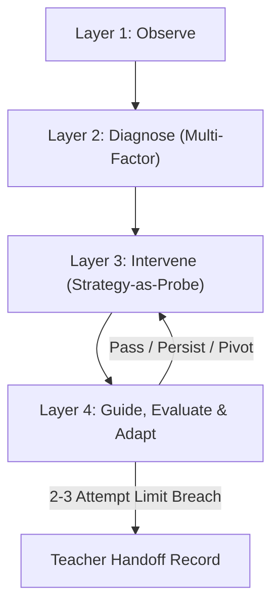

# AIPC Knowledgebase Explorer and Pedagogical Reasoning Simulator

## 1. Overview & Architecture

The **AIPC Knowledgebase Explorer and Reasoning Simulator** provides an inspectable, end-to-end framework for pedagogical reasoning across four distinct layers:



### The 4 Layers

1. **Layer 1: Observe (Signal Detection & Telemetry)**
   - *Inputs*: Audio/MIDI note onset performance telemetry, score context (MusicXML), tempo drift slopes, local note error clusters.
   - *Outputs*: Detected problem signature (e.g. `PS-RUSH-01`), localized error bars, and quantified telemetry metrics.
   - *Key KB*: Problem Signatures (`problem_signature`).

2. **Layer 2: Diagnose (Multi-Factor Provisional Profile)**
   - *Inputs*: Observed signature and baseline telemetry.
   - *Outputs*: `DiagnosticProfile` with multiple ranked hypotheses (`CapacityHypothesis[]`) and supporting evidence (`DiagnosticEvidence[]`).
   - *Pedagogical Invariant*: **No single root cause is forced prematurely.** A problem like progressive rushing is provisionally attributed across multiple plausible capacities (e.g. RC03, RC08, RC04, RC05).
   - *Key KB*: Rhythmic Capacities (`capacity`, RC01–RC13).

3. **Layer 3: Intervene (Strategy-as-Probe)**
   - *Inputs*: Provisional profile and Repertoire Front Door router.
   - *Outputs*: Diagnostic probe launch (Option A or Option B) with learner choice, isolated variables, and attempt limits.
   - *Key KB*: Diagnostic Interventions (`diagnostic_intervention`), Strategies (`strategy`), Required Assets (`asset`).

4. **Layer 4: Guide, Evaluate & Adapt (Diagnostic Sieve & Bounded Loop)**
   - *Inputs*: Student response telemetry post-probe.
   - *Outputs*: Four possible outcomes: `Pass`, `Persist`, `Pivot`, or `Refer`.
   - *Pedagogical Invariant*: **Strict 2–3 attempt limit.** If a student fails to resolve a bottleneck across 2–3 focused attempts, automated probing halts and an explicit `TeacherHandoffRecord` is produced.
   - *Key KB*: Response Interpretation Rules (`response_rule`), Progression Rules (`progression_rule`), Referral Rules (`referral_rule`).

---

## 2. Seven Musical Domains

To preserve holistic pedagogical organization without polluting the codebase with hallucinated data, knowledge is structured across 7 domains:

| Domain ID | Domain Name | Status | Records |
| :--- | :--- | :--- | :--- |
| `rhythm` | Rhythm & Metric Organisation | **Implemented** | RC01–RC13, PS-RUSH-01, DI Probes, Rules |
| `tone` | Tone Quality & Timbre | Placeholder | 0 fabricated records (schema ready) |
| `pitch_intonation` | Pitch & Intonation | Placeholder | 0 fabricated records (schema ready) |
| `articulation` | Articulation & Note Enunciation | Placeholder | 0 fabricated records (schema ready) |
| `technique_coordination` | Technique & Motor Coordination | Placeholder | 0 fabricated records (schema ready) |
| `breathing_air_support` | Breathing & Air Support | Placeholder | 0 fabricated records (schema ready) |
| `expression_style` | Expression & Stylistic Nuance | Placeholder | 0 fabricated records (schema ready) |

---

## 3. Programmatic & HTTP API Reference

The simulator engine is accessible both programmatically in TypeScript and via HTTP endpoints on the Vite dev server.

### TypeScript Service (`KnowledgeSimulatorService`)

```typescript
import { KnowledgeSimulatorService } from './src/backend/service/KnowledgeSimulatorService';

// 1. Browse domains and layers
const domains = KnowledgeSimulatorService.getDomains();
const layers = KnowledgeSimulatorService.getLayers();

// 2. Start a simulation
const sim = KnowledgeSimulatorService.startSimulation({
  domainId: 'rhythm',
  problemSignatureId: 'PS-RUSH-01',
  scenarioId: 'neruda_bars_12_15',
});

// 3. Apply an intervention choice (Option A or Option B)
const withIntervention = KnowledgeSimulatorService.applyIntervention(sim.id, {
  interventionId: 'DI-REF-SHADOW-01',
  learnerChoice: 'Option A',
});

// 4. Record student performance response
const withResponse = KnowledgeSimulatorService.recordResponse(sim.id, {
  responsePattern: 'response_a_shadow_improved',
  attemptCount: 2,
});

// 5. Save developer / pedagogical notes
KnowledgeSimulatorService.saveNote(
  sim.nodes[0].id,
  'Pedagogical Lead',
  'Verify that drift slope calculation excludes rest bars.'
);

// 6. Generate 1-click instruction prompt for coding agents
const agentPrompt = KnowledgeSimulatorService.generateCodingInstructions(sim.id);
console.log(agentPrompt.instructionsMarkdown);
```

### HTTP Endpoints (Vite Middleware)

- `GET /knowledge/domains`: Lists all 7 domains.
- `GET /knowledge/domains/:domainId`: Gets domain metadata and record IDs.
- `GET /knowledge/layers`: Lists 4 pedagogical layers and associated knowledgebases.
- `GET /knowledge/records/:recordId`: Retrieves full record schema by ID.
- `GET /simulations/problem-signatures`: Retrieves registered problem signatures.
- `POST /simulations/start`: Starts a new simulation session.
- `POST /simulations/:id/apply-intervention`: Selects and launches a probe.
- `POST /simulations/:id/record-response`: Simulates student telemetry and executes adaptation.
- `GET /simulations/:id/trace`: Fetches the complete ordered reasoning trace.
- `POST /simulations/:id/notes`: Adds a note to a record or node.
- `GET /simulations/:id/coding-instructions`: Generates markdown prompt for coding agents.
- `GET /knowledge/validate`: Validates static schema and trace invariants.

---

## 4. Canonical Response Sieve (Responses A through E)

When evaluating `PS-RUSH-01` (Progressive Rushing), AIPC evaluates the probe results against five canonical responses:

```
                                  [ Baseline: Progressive Rushing Detected ]
                                                      |
                                       [ Front Door: Option A or Option B ]
                                                      |
              +-------------------+-------------------+-------------------+-------------------+
              |                   |                   |                   |                   |
        [ Response A ]      [ Response B ]      [ Response C ]      [ Response D ]      [ Response E ]
        Shadow Fingering    -20 BPM Slow Tempo   Tied Rhythm Fails   Local 1-2 Note      Stable with Click,
           Succeeds              Succeeds         at Slower Tempo       Bottleneck       Drifts when Drops
              |                   |                   |                   |                   |
          RC05/RC08           Speed Load          RC04/RC05           RC08 Motor             RC03
         Bottleneck           Confirmed           Bottleneck          Bottleneck        Internal Pulse
              |                   |                   |                   |                   |
           PERSIST             PERSIST              PIVOT               REFER/PIVOT         PIVOT
              +                   +                   +                   +                   +
          Retest w/o         Progressive         Targeted Rhythm      Bounded to max 3     Gap Click Fading
          Scaffolding        Tempo Ladder          (X-Ray / Subdiv)    -> Teacher Handoff     (Levels 5 -> 1)
```

---

## 5. Developer & Pedagogy Notes: Copy Instructions for Coding Agents

Pedagogical designers and developers can record annotations directly on any knowledge record or reasoning node in the UI.

Clicking **"📋 Copy Instructions for Coding Agents"** formats a comprehensive, ready-to-paste markdown prompt containing:
1. **Target context & Diagnostic Profile** (leading hypotheses, evidence scores, and unresolved questions).
2. **Step-by-step reasoning trace** with plain-language explanations and applied rules.
3. **Decision outcome** (`Pass`, `Persist`, `Pivot`, or `Refer`) and any teacher handoff details.
4. **Developer & Designer Notes** appended to the session.
5. **Clear, actionable constraints** for AI coding assistants (preserving multi-factor uncertainty, bounding attempt limits, requiring transfer retests).

---

## 6. Verification and Automated Testing

Run the automated test suite with:

```bash
npm test
```

This verifies all 12 core requirements in `tests/knowledgeSimulator.test.ts`:
- All 7 domains present (rhythm implemented + 6 isolated placeholders).
- 4 layers in strict sequential order.
- Multi-factor provisional profile generation.
- Repertoire Front Door option routing with attempt bounds <= 3.
- Responses A, B, C, D, and E execution.
- 2–3 attempt referral limit and teacher handoff generation.
- Integrity invariant validation with 0 errors.
- Note recording and coding agent instruction synthesis.
